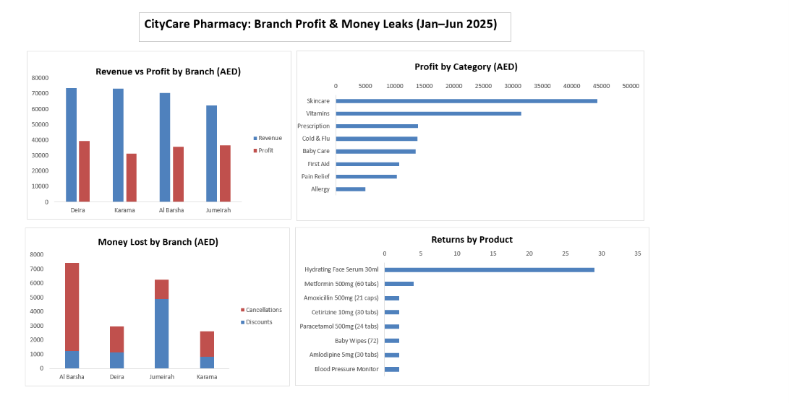

# CityCare Pharmacy: Branch Profit & Money Leaks (Excel)

Cleaning a very messy pharmacy sales export in Excel and finding **which branch really makes money, which products drive profit, and where money is leaking**.

## The brief
"The sales export from our 4 branches is a mess and the numbers never add up. Which branch is really doing best? Which products actually make us money? And returns seem high, especially skincare. Is that real?"

## Questions answered
1. Which branch brings the most revenue AND profit?
2. Which product categories bring the most profit?
3. Where are we losing money: discounts, cancellations or returns?

## Key findings
- **Deira is the best branch:** most revenue (73.7K AED) and most profit (39.4K AED, 54% margin).
- **Karama sells almost as much as Deira but keeps the least profit (43% margin)** because 42% of its sales are prescriptions, which have a 22% margin.
- **Jumeirah has the lowest revenue but the best margin (58%)**: 61% of its sales are skincare and vitamins.
- **Skincare makes the most profit (44.3K AED, 68% margin); Vitamins have the best margin (71%).**
- **About 22,900 AED leaked away:**
  - Cancellations: 11,203 AED (56% at Al Barsha), the biggest leak
  - Discounts: 8,082 AED (61% at Jumeirah)
  - Returns: 3,582 AED, the smallest leak, but 53% come from one product: Hydrating Face Serum 30ml

## Recommendations
1. **Fix cancellations at Al Barsha first:** check the till process, staff training and stock levels.
2. **Review Jumeirah's discounts:** its customers already buy high-margin products, so heavy promotions may not be needed.
3. **Investigate Hydrating Face Serum:** check customer complaints, the batch and the product description.
4. **Don't judge Karama on margin alone:** its low margin comes from serving prescription customers, not poor management.

## Data cleaning (Power Query)
Raw export: 6,742 rows → clean: **6,636 rows**

| Problem | Fix |
|---|---|
| 3 junk rows above the headers | Removed top rows, promoted headers |
| 85 duplicate rows | Remove Duplicates |
| 14 test transactions (TEST-xxx) | Filter: does not begin with "TEST" |
| 7 typo quantities (100–500 of one item) | Removed and recorded (true value unknown) |
| Branch names: 19 spellings | Trim, Capitalize, Replace → 4 branches |
| Status: Void / Canceled / Complete... | Standardised to Completed / Cancelled / Returned |
| Payment method spellings and blanks | Card / Cash / Insurance / Unknown |
| Quantity as text ("2 units", "1 pcs") | Removed text, set to whole number |
| Price as text ("AED 18.00") and blanks | Removed "AED"; blanks filled from the product list price |
| Discount in 4 formats (10%, 0.1, 10, blank) | Standardised to a decimal (0.1 = 10%) |
| Dates in 4 formats | Converted with the UK locale (day/month/year) |
| Hidden spaces and lowercase in product IDs | Trim + Uppercase |
| 58 rows with no product ID | Labelled "Unknown", excluded from money analysis |

## How I calculated profit
- final_price = till price, or the list price if blank
- revenue = quantity × final_price × (1 − discount), 0 if cancelled
- cost = quantity × unit_cost
- profit = revenue − cost; margin = profit ÷ revenue
- Returns have negative quantity, so they reduce revenue

## Checks I used
- Predicted the clean row count and compared it with the actual (this found 12 test rows and 7 typo rows that had slipped through)
- Tested lookups with a known product (P001 must be Pain Relief)
- Checked one row by hand for each money formula

## Tools
Excel: Power Query, XLOOKUP, IF, pivot tables, calculated fields, PivotCharts

## Data
**Simulated dataset** of a fictional pharmacy chain (CityCare, 4 Dubai branches, Jan–Jun 2025), deliberately built with real-world data problems for cleaning practice. Prices in AED.

## Files
- `citycare_pharmacy_sales.xlsx`: the original messy export (before)
- the analysis workbook: Power Query cleaning, pivots and dashboard (after)
- `images/dashboard.png`: dashboard screenshot
